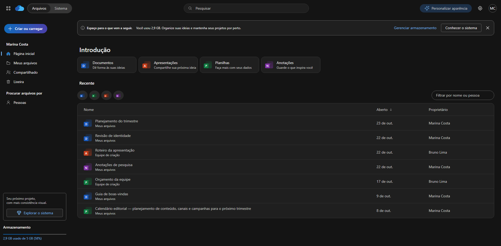

# Cloudscape UI

Design system independente inspirado na página inicial do OneDrive, observado com REA e adaptado para aplicações web. Inclui **73 tokens**, **18 componentes React**, CSS reutilizável e uma demonstração com conteúdo fictício.

## Começar pelo repositório

```sh
git clone https://github.com/claudio-mas/cloudscape-ui.git
cd cloudscape-ui
npm ci
npm run build
npm test
npm run dev
```

- [Guia de integração](GUIA_DE_INTEGRACAO.md): CSS, React/TypeScript, tabela controlada, personalização e temas.
- [Demonstração independente](DEMO.html): baixe o repositório e abra este arquivo no navegador.
- [Pacote React 1.1.0](cloudscape-ui-1.1.0.tgz): instale no seu projeto com `npm install /caminho/cloudscape-ui-1.1.0.tgz`.
- [Validação](VALIDATION.md) e [origem do design](EVIDENCE.md).



## Ver o resultado

Abra `DEMO.html` diretamente no Edge ou Chrome. O arquivo contém a demonstração completa, sem instalação, conta Microsoft ou conexão de rede. Use o seletor **Arquivos / Sistema** na barra superior para alternar entre a aplicação e o catálogo. Para desenvolver, use os comandos abaixo.

## Estrutura

| Arquivo/pasta | Uso |
|---|---|
| `tokens.json` | Valores base e tema claro |
| `tokens.dark.json` | Overrides semânticos do tema escuro |
| `tokens.css` | Variáveis CSS geradas, todas com prefixo `--cs-` |
| `components.css` | Estilos dos componentes, com prefixo `cs-` |
| `react/` | Fontes TypeScript dos componentes e funções de dados |
| `dist/` | Biblioteca React compilada em ESM, com declarações de tipos |
| `demo/` | Aplicação e catálogo em React |
| `preview/` | Demonstração compilada para servir por HTTP |
| `DEMO.html` | Demonstração autossuficiente, pronta para abrir |
| `images/` | Capturas da demonstração, sem dados da conta do usuário |
| `EVIDENCE.md` | Medições, fontes, adaptações e limitações |
| `VALIDATION.md` | Verificações realizadas |

## Usar somente CSS

Copie `tokens.css` e `components.css` para seu projeto e carregue nessa ordem:

```html
<link rel="stylesheet" href="/styles/tokens.css">
<link rel="stylesheet" href="/styles/components.css">
<div class="cs-ui">
  <button type="button" class="cs-button cs-button--primary">Criar projeto</button>
</div>
```

As classes visuais são reutilizáveis em outros frameworks. Menus, filtros e seleção precisam da lógica da sua aplicação; os componentes React já oferecem essa camada.

## Usar em React

O ZIP também inclui o pacote instalável `cloudscape-ui-1.1.0.tgz`. No seu projeto React:

```sh
npm install /caminho/para/cloudscape-ui-1.1.0.tgz
```

Como alternativa, instale a partir da pasta extraída:

```sh
npm install /caminho/para/onedrive-design-system
```

Ou copie `react/`, `tokens.css` e `components.css` para seu projeto TypeScript. Para o pacote compilado:

```tsx
import { useState } from 'react';
import { Button, SearchField } from 'cloudscape-ui';
import 'cloudscape-ui/tokens.css';
import 'cloudscape-ui/components.css';

export function MyScreen() {
  const [query, setQuery] = useState('');
  return (
    <div className="cs-ui">
      <SearchField label="Pesquisar projetos" value={query} onChange={setQuery} />
      <Button variant="primary" icon="plus" onClick={() => console.log('Criar')}>
        Criar projeto
      </Button>
    </div>
  );
}
```

React e React DOM são dependências do projeto consumidor. A biblioteca compilada deixa o React externo; não inclui outra cópia do React.

## Componentes

| Componente | Propriedades principais |
|---|---|
| `AppShell` | `header`, `sidebar`, `children`, `style` |
| `SidebarLink` | `icon`, `active`, `href`, `onClick` |
| `Button` | `variant`: primary/secondary/ghost/soft, `icon`, atributos nativos |
| `IconButton` | `label` obrigatório, `icon`, atributos nativos |
| `SearchField` | `label`, `value`, `onChange(value)` |
| `SegmentedControl` | `label`, `options`, `value`, `onChange(value)` |
| `Notice` | `label`, `children`, `actions`, `onDismiss` |
| `QuickCard` | `kind`, `title`, `description`, `onClick` |
| `FilterChips` | `value: FileKind[]`, `onChange(value)` |
| `FileBadge` | `kind`: doc/sheet/slides/note, `small` |
| `FileTable` | `files`, `selection`, `onSelectionChange`, `sort`, `direction`, `onSort`, `onOpen`, `formatDate` |
| `ActionMenu` | `label`, `items`, `icon`, `variant` |
| `Avatar` | `name`, `initials`, `onClick` |
| `UsageMeter` | `label`, `value`, `max`, `detail` |
| `EmptyState` | `title`, `description`, `action` |
| `Skeleton` | `rows` |
| `ThemeProvider` | `children`, `storageKey` opcional |
| `ThemeSwitcher` | Seletor Claro / Escuro / Sistema integrado ao provider |

`Icon`, `CloudMark`, `FILE_LABELS`, `getVisibleFiles`, `toggleVisibleSelection`, `useTheme` e `createThemeStore` também são exportados. Os tipos completos acompanham `dist/` e os fontes.

### Tabela controlada

```tsx
import { useState } from 'react';
import { FileTable, getVisibleFiles, type FileRecord, type FileSort } from 'cloudscape-ui';

export function Documents({ files }: { files: FileRecord[] }) {
  const [selection, setSelection] = useState<Set<string>>(new Set());
  const [sort, setSort] = useState<FileSort>('name');
  const [direction, setDirection] = useState<'asc' | 'desc'>('asc');
  return <div className="cs-ui"><FileTable
    files={getVisibleFiles(files, { sort, direction })}
    selection={selection}
    onSelectionChange={setSelection}
    sort={sort}
    direction={direction}
    onSort={key => {
      setDirection(key === sort && direction === 'asc' ? 'desc' : 'asc');
      setSort(key);
    }}
  /></div>;
}
```

Um `FileRecord` possui `id`, `name`, `location`, `owner`, `type` e `openedAt` em ISO 8601. Use identificadores únicos e estáveis. `FileTable` renderiza os dados fornecidos; use `getVisibleFiles` ou sua própria consulta para filtrar e ordenar. A seleção de todos afeta apenas as linhas visíveis e preserva seleções ocultas.

## Personalizar

Edite `tokens.json` e `tokens.dark.json` e execute `npm run tokens`, ou sobrescreva as variáveis em um contêiner:

```css
.my-brand.cs-ui {
  --cs-color-brand: #107c41;
  --cs-color-brand-indigo: #25655d;
  --cs-color-brand-foreground: #107c41;
  --cs-color-brand-hover: #0b6233;
  --cs-color-brand-soft: #e6f2eb;
  --cs-color-focus: #0b6233;
}
```

Em React, essas variáveis também podem ser fornecidas por `style` no contêiner. Ajuste todos os estados e verifique contraste ao criar um tema para produção. Os chips do catálogo alteram o gradiente e adaptam a cor de texto da marca ao modo ativo. A cor de foco é independente da marca para manter contraste.

## Temas Claro / Escuro / Sistema

Na demonstração, abra **Configurações de aparência** (engrenagem) ou a seção **Personalização** do catálogo. A preferência padrão é **Sistema**. A escolha explícita é salva na chave `cloudscape.theme`; quando Sistema está ativo, mudanças do computador são acompanhadas automaticamente.

Para adicionar a configuração ao seu aplicativo:

```tsx
import { ThemeProvider, ThemeSwitcher, useTheme } from 'cloudscape-ui';
import 'cloudscape-ui/tokens.css';
import 'cloudscape-ui/components.css';

export function Application() {
  return <ThemeProvider>
    <div className="cs-ui">
      <ThemeSwitcher />
      <YourApplication />
    </div>
  </ThemeProvider>;
}
```

Use um `ThemeProvider` na raiz. Ele controla o tema do documento, incluindo menus, diálogos, campos e barras de rolagem. `useTheme()` retorna `preference`, `resolvedTheme` e `setPreference('light' | 'dark' | 'system')`. O `storageKey` opcional deve permanecer estável durante a vida do provider. A implementação também aceita renderização no servidor, com snapshot inicial estável.

Somente CSS: defina `data-cs-theme="light"` ou `data-cs-theme="dark"` no elemento `html`. Use `data-cs-theme="system"`, ou remova o atributo, para seguir `prefers-color-scheme`. Contêineres `.cs-ui` também aceitam um atributo explícito `data-cs-theme="light"` ou `data-cs-theme="dark"` para isolar uma aparência. Persistência e o seletor de três modos são fornecidos pela camada React.

O armazenamento é local ao navegador e à origem. Se estiver indisponível, a troca continua funcionando na sessão atual. Em páginas abertas como arquivo local, a persistência depende do navegador; em aplicações publicadas, use a origem HTTP(S) habitual.

`tokens.json` preserva o formato anterior. `tokens.dark.json` acrescenta 22 overrides; `tokens.css` já inclui os dois temas. O botão **Baixar tokens** do catálogo exporta ambos em `cloudscape.themes.json`, com as chaves `light` e `dark`.

A paleta escura é uma adaptação do kit; não foi apresentada como uma extração do CSS privado do OneDrive.

## Desenvolver e compilar

Use Node.js 24.21 ou mais recente da linha 24 e npm. As versões exatas estão no arquivo de lock.

```sh
npm ci
npm run dev
npm run build
npm test
```

`npm run build` gera tokens, verifica tipos, compila a biblioteca, gera a demonstração para HTTP e cria `DEMO.html`. Para distribuir como pacote, execute `npm pack`; CSS e arquivos compilados estão na lista de publicação.

## Comportamento da demonstração

- Busca tolerante a acentos, filtros combináveis, ordenação e seleção múltipla.
- Menus com setas, Home/End e Escape; foco devolvido ao botão.
- Criação de itens e seleção de arquivos locais são exemplos em memória. Nenhum upload é realizado; recarregar restaura os dados fictícios.
- Diálogos mostram detalhes de exemplo. Não abrem documentos reais.
- Navegação lateral recolhível abaixo de 760 px; tabela com rolagem interna em telas estreitas.
- Foco visível, nomes acessíveis, preferência de movimento reduzido e cores forçadas.

## Origem e limites

O kit reproduz uma linguagem visual equivalente, não o CSS original completo do OneDrive. Os nomes e ícones são próprios e substituíveis. Breakpoints e estados não observados na conta são decisões desta implementação. Veja `EVIDENCE.md`.

Não é um produto oficial ou afiliado à Microsoft. O código original deste kit usa licença MIT; dependências mantêm suas próprias licenças. As fontes do sistema são referenciadas, não redistribuídas.
